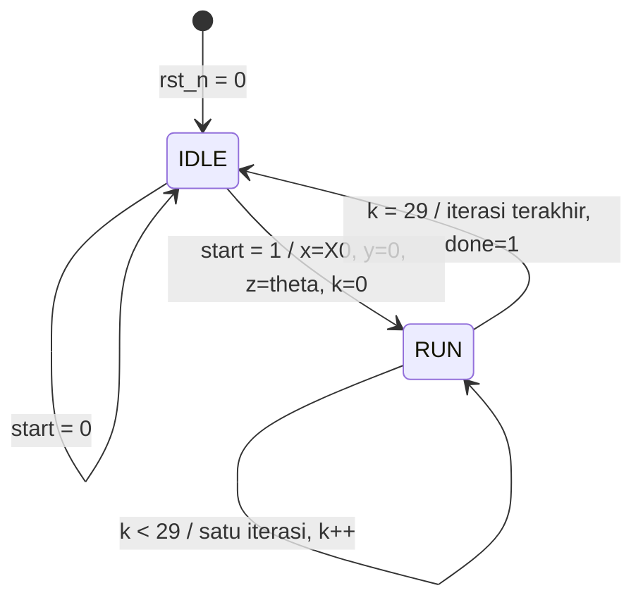

# Tubes Sisdig : CORDIC Hiperbolik (sinh, cosh) untuk FPGA

Implementasi CORDIC mode hiperbolik (rotation mode) dalam Verilog dan VHDL. Modul menghitung `cosh(theta)` dan `sinh(theta)` hanya dengan penjumlahan, pengurangan, dan geser bit, tanpa multiplier. Arsitektur iteratif, fixed-point Q4.28, target board DE10-Lite (MAX 10).

## Spesifikasi

| Item | Nilai |
|---|---|
| Format data | signed Q4.28 (32 bit, 28 bit pecahan) |
| Arsitektur | iteratif, satu stage dipakai berulang |
| Jumlah iterasi | 30 (28 indeks, i = 4 dan i = 13 diulang) |
| Latensi | 30 clock dari `start` diterima sampai `done` |
| Rentang input | `abs(theta) <= 1.118` rad (batas absolut 0x11E40963 = 1.11817) |
| Galat maksimum (simulasi) | 8 LSB (sekitar 3e-8) pada 45 titik uji |
| Reset | asinkron, aktif low (`rst_n`) |

## Struktur berkas

| Berkas | Isi |
|---|---|
| `cordic_hyp.v` | modul Verilog |
| `cordic_hyp.vhd` | modul VHDL (fungsi identik) |
| `tb_cordic_hyp.v` | testbench Verilog |
| `tb_cordic_hyp.vhd` | testbench VHDL |

## Algoritma

### Fungsi hiperbolik

```
sinh t = (e^t - e^-t) / 2
cosh t = (e^t + e^-t) / 2
cosh^2 t - sinh^2 t = 1
```

Titik `(cosh t, sinh t)` bergerak di sepanjang hiperbola `x^2 - y^2 = 1`, sedangkan `(cos t, sin t)` berputar di lingkaran. Fungsi hiperbolik tidak periodik.

### Rotasi mikro

Rotasi hiperbolik sebesar `phi` dapat ditulis:

```
[x']            [1       tanh phi] [x]
[y'] = cosh phi [tanh phi    1   ] [y]
```

Dengan `phi_i = atanh(2^-i)` maka `tanh phi_i = 2^-i`, sehingga perkalian dengan `2^-i` hanyalah geser kanan sebanyak `i` bit. Faktor `cosh phi_i` dibuang agar tidak butuh perkalian. Sudut target dipecah menjadi jumlah sudut kecil `theta = sum(d_i * atanh(2^-i))` dengan `d_i = +1` atau `-1`.

Satu iterasi (rotation mode):

```
d  = (z >= 0) ? +1 : -1
x' = x + d * (y >> i)
y' = y + d * (x >> i)
z' = z - d * atanh(2^-i)
```

`z` adalah sisa sudut yang belum diputar. Nilai awal `x = 1/Kh`, `y = 0`, `z = theta`. Setelah semua iterasi, `z` mendekati 0, `x = cosh(theta)`, dan `y = sinh(theta)`.

Nilai `d` selalu +1 atau -1, tidak pernah 0. Setiap langkah wajib dijalankan agar gain `Kh` konstan.

### Gain Kh

Karena `cosh phi_i` dibuang, tiap langkah mengecilkan vektor dengan faktor `sqrt(1 - 4^-i)`. Total untuk seluruh jadwal:

```
Kh = produk sqrt(1 - 4^-i)  untuk semua i di jadwal  = 0.828159
x0 = 1 / Kh = 1.207497  (0x1351E872 dalam Q4.28)
```

Penyusutan tidak bergantung pada `theta` maupun arah rotasi (karena `d^2 = 1`), sehingga cukup dikompensasi sekali lewat nilai awal `x0`. Kh dihitung dengan memasukkan iterasi yang diulang. Tanpa pengulangan nilainya 0.82978, dan selisih itu merusak hasil.

### Jadwal iterasi dan pengulangan

Iterasi dimulai dari `i = 1` karena `atanh(2^0)` tak hingga. Jadwal untuk N = 28:

```
k: 0 1 2 3 4 5 6 ... 13 14 15 ... 29
i: 1 2 3 4 4 5 6 ... 13 13 14 ... 28
```

Pengulangan diperlukan karena pada hiperbolik koin `atanh(2^-i)` sedikit lebih besar dari jumlah semua koin sesudahnya. Selisih ini disebut kekurangan, dan sebesar sekitar `(2/7) * 2^-3i`:

| i | koin | jumlah koin sesudahnya | kekurangan |
|---|---|---|---|
| 1 | 0.549306 | 0.506163 | 4.3e-2 |
| 2 | 0.255413 | 0.250750 | 4.7e-3 |
| 3 | 0.125657 | 0.125093 | 5.6e-4 |
| 4 | 0.062582 | 0.062512 | 7.0e-5 |
| 5 | 0.031260 | 0.031251 | 8.7e-6 |

Karena tiap koin wajib dibayar, kekurangan ini menjadi sisa `z` yang tidak bisa dihabiskan. Contoh: `theta = 0.41955` tanpa pengulangan berakhir dengan `z = -7.0e-5` (sekitar 14 bit presisi), dengan pengulangan `z = 3e-9`.

Satu koin tambahan menutup satu blok indeks sebelumnya. Koin tambahan ditaruh di indeks paling akhir yang koinnya masih lebih besar dari kekurangan indeks pertama yang belum aman:

```
awal = 1
while kekurangan(awal) > 2^-N:
    j = indeks terbesar dengan atanh(2^-j) >= kekurangan(awal)
    ulang j
    awal = j
```

Hasilnya `4 -> 13 -> 40 -> ...` (rumus `j = 3i + 1`). Pengulangan dibutuhkan jika kekurangannya lebih besar dari `2^-N`:

| Pengulangan | Kekurangan yang ditutup | Dibutuhkan jika |
|---|---|---|
| 4 | 4.3e-2 | N >= 5 |
| 13 | 7.0e-5 | N >= 14 |
| 40 | 5.2e-13 | N >= 41 |

Untuk N = 28 cukup mengulang 4 dan 13.

### Contoh perhitungan, theta = 0.5

Target: `cosh 0.5 = 1.127626`, `sinh 0.5 = 0.521095`.

| langkah | i | d | x | y | z |
|---|---|---|---|---|---|
| awal | | | 1.207497 | 0.000000 | 0.500000 |
| 1 | 1 | +1 | 1.207497 | 0.603749 | -0.049306 |
| 2 | 2 | -1 | 1.056560 | 0.301874 | 0.206107 |
| 3 | 3 | +1 | 1.094294 | 0.433944 | 0.080449 |
| 4a | 4 | +1 | 1.121416 | 0.502338 | 0.017868 |
| 4b | 4 | +1 | 1.152812 | 0.572426 | -0.044714 |
| 5 | 5 | -1 | 1.134924 | 0.536401 | -0.013454 |
| 6 | 6 | -1 | 1.126542 | 0.518668 | 0.002173 |
| 7 | 7 | +1 | 1.130594 | 0.527469 | -0.005640 |

`z` bolak-balik di sekitar 0 dengan amplitudo mengikuti koin yang makin kecil, sehingga `x` dan `y` konvergen ke target.

## Arsitektur hardware

### Port

| Port | Arah | Keterangan |
|---|---|---|
| `clk` | in | clock |
| `rst_n` | in | reset asinkron aktif low |
| `start` | in | pulsa mulai, diabaikan saat modul sibuk |
| `theta` | in | sudut, signed Q4.28, disampel saat `start` diterima |
| `done` | out | pulsa 1 clock saat hasil valid |
| `cosh_o` | out | signed Q4.28, valid saat `done` dan bertahan sampai `start` berikutnya |
| `sinh_o` | out | signed Q4.28, valid saat `done` dan bertahan sampai `start` berikutnya |

Selama proses berjalan, `cosh_o` dan `sinh_o` menampilkan nilai antara dan tidak boleh dipakai.

### Datapath

Satu iterasi per clock:

- **Counter `k`** (0 sampai 29) menunjuk langkah jadwal.
- **Blok shift** mengubah `k` menjadi `i`: `k <= 2` maka `k + 1`, `k <= 4` maka `4`, `k <= 13` maka `k`, selain itu `k - 1`. Di sinilah pengulangan 4 dan 13 diterapkan.
- **ROM `ang`** (case statement) berisi `atanh(2^-i)` untuk tiap `k`, termasuk entri ganda untuk iterasi yang diulang.
- **Barrel shifter** menghitung `dx = y >>> i` dan `dy = x >>> i` (geser aritmetik).
- **Tiga adder/subtractor** untuk `x`, `y`, `z`. Arah ditentukan bit tanda `z[31]` (`1` berarti `d = -1`).

### FSM

Dua state, dikodekan oleh register `busy`:



| State | `busy` | Aksi |
|---|---|---|
| IDLE | 0 | menunggu `start`. Jika `start = 1`: muat `x = X0`, `y = 0`, `z = theta`, `k = 0`, lalu `busy = 1` |
| RUN | 1 | jalankan satu iterasi tiap clock. Pada `k = 29`: `busy = 0` dan `done = 1`, jika tidak `k = k + 1` |

`done` default 0 di setiap clock dan hanya bernilai 1 pada clock setelah iterasi terakhir, bersamaan dengan `x` dan `y` final.

### Contoh pemakaian

```verilog
cordic_hyp u_cordic (
    .clk(clk), .rst_n(rst_n), .start(start), .theta(theta_q428),
    .done(done), .cosh_o(cosh_q428), .sinh_o(sinh_q428)
);
```

## Fixed-point Q4.28

- Nilai nyata = `integer / 2^28`. Contoh: `0.5` menjadi `134217728` (0x08000000).
- Rentang representasi sekitar -8 sampai +8. Nilai antara `x` dan `y` untuk input yang valid tidak melebihi sekitar 1.7.
- Geser aritmetik memotong ke arah minus tak hingga (floor). Tiap langkah menambah galat sampai sekitar 1 LSB, sehingga galat akhir beberapa LSB. Galat ini bisa dikecilkan dengan menambah guard bit.

## Membuat konstanta

`X0` dan tabel `atanh(2^-i)` dihitung sekali di luar FPGA:

```python
import math

N, F = 28, 28
seq = []
for i in range(1, N + 1):
    seq.append(i)
    if i in (4, 13):
        seq.append(i)

kh = 1.0
for i in seq:
    kh *= math.sqrt(1 - 4.0 ** -i)

print(f"X0 = {round(2**F / kh):08X}")
for k, i in enumerate(seq):
    print(f"{k}: {round(math.atanh(2.0 ** -i) * 2**F)}")
```

Jika N diubah, jadwal pengulangan, blok shift, ROM, `X0`, dan konstanta `N` di modul harus disesuaikan.

## Simulasi

Verilog (Icarus Verilog):

```
iverilog -g2005 -o sim cordic_hyp.v tb_cordic_hyp.v
vvp sim
```

VHDL (GHDL):

```
ghdl -a --std=08 cordic_hyp.vhd tb_cordic_hyp.vhd
ghdl -e --std=08 tb_cordic_hyp
ghdl -r --std=08 tb_cordic_hyp
```

Testbench menguji 45 nilai `theta` dari -1.10 sampai 1.10 (langkah 0.05), membandingkan dengan `exp` (Verilog) atau `cosh`/`sinh` dari `math_real` (VHDL), lalu mencetak galat dalam LSB dan `PASS` jika galat maksimum di bawah 64 LSB.

Hasil (Icarus Verilog 12.0 dan GHDL 4.1.0 memberikan galat yang sama):

| theta | cosh | sinh | galat cosh (LSB) | galat sinh (LSB) |
|---|---|---|---|---|
| -1.10 | 1.668518562 | -1.335647464 | 2.2 | 1.7 |
| -0.65 | 1.218793284 | -0.696747530 | 5.0 | 1.1 |
| -0.20 | 1.020066746 | -0.201336015 | 2.7 | 3.3 |
| 0.25 | 1.031413119 | 0.252612323 | 5.2 | 1.5 |
| 0.70 | 1.255168993 | 0.758583687 | 3.4 | 3.9 |

Galat maksimum seluruh uji: **8 LSB**.

## Keterbatasan

- **Rentang**: `abs(theta) <= 1.118` rad. Di luar itu hasil salah (galat meledak mulai sekitar 1.1182). Untuk input lebih besar perlu range reduction, misalnya mengurangi kelipatan `ln 2` lalu memakai `e^x = 2^n * e^r`.
- **Barrel shifter**: shift variabel dari counter membuat area dan delay lebih besar daripada versi pipelined dengan shift berupa kabel konstan.
- **Belum diverifikasi**: sintesis Quartus (penggunaan LE, fmax) dan uji pada board DE10-Lite. Verifikasi saat ini hanya simulasi.

## Pengembangan

- Versi pipelined (satu stage per iterasi, 1 hasil per clock).
- Mode vectoring untuk `atanh`, `ln`, dan `sqrt`.
- CORDIC sirkular (sin, cos) dengan struktur sama untuk rotasi pada grafis.
- Guard bit untuk memperkecil galat pembulatan.
